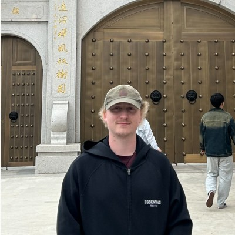
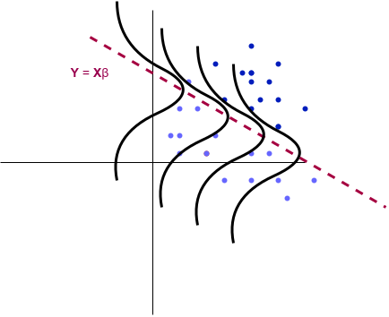
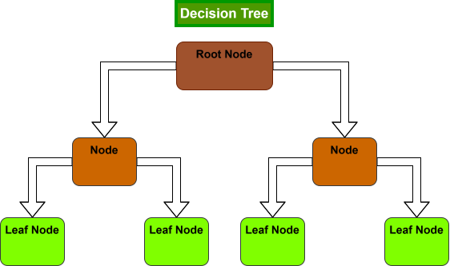
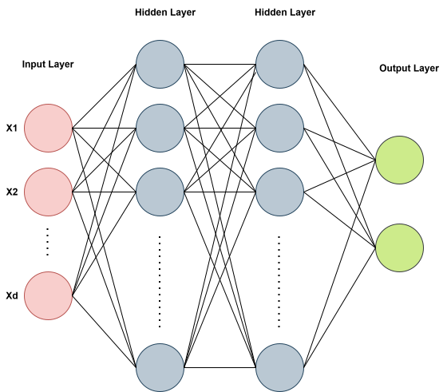

::: {.homepage-intro}

::: {.profile-photo}
{width=180px}
:::

::: {.homepage-text}

***Statistics*** $\quad$ ***Machine Learning*** $\quad$ ***Optimization***

My name is Joseph Casey, and I recently obtained my PhD in Applied Mathematics from The University of Alabama at Birmingham.
I obtained my Bachelor's degree in Mathematics from Auburn in 2020, where I enjoyed pursuing my interests in cybersecurity. Recently, my interests pertain to statistics, optimization, and machine learning, however, I still enjoy learning about a wide range of topics within math and computer science.

[[Github](https://github.com/josephcasey922)]{style="font-size: 15px;"} $\quad$ [[Resume](files/joseph-casey-resume.pdf)]{style="font-size: 15px;"} $\quad$ [LinkedIn](https://www.linkedin.com/in/joseph-casey-bbb396435){style="font-size: 15px;"}
---

:::

:::

## Featured Project

**Research Landscape**

An AI assisted system for exploring relationships, methodologies, contributions, and potential connections across scientific literature.

[view project v0.1 $\rightarrow$](projects/research-landscape/)

## Recent Articles

**Generalized Linear Models**

An introduction to the GLM framework and statistical modeling

{width="30%"}

[View Overview $\rightarrow$](articles/generalized-linear-models)

---

**Decision Trees**

A from-scratch implementation of decision trees in Python (NumPy)

{width="30%"}

[View Article $\rightarrow$](articles/decisiontrees-from-scratch)

---

**Multilayer Perceptron from scratch**

A from-scratch implementation of a basic neural network in Python

{width="30%"}

[View Article $\rightarrow$](articles/mlp-from-scratch)

---

::: {.center data-latex=""}
[View All Articles](articles/)
:::

 

