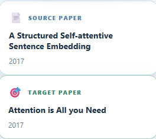
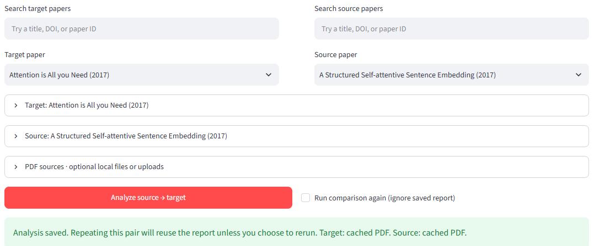
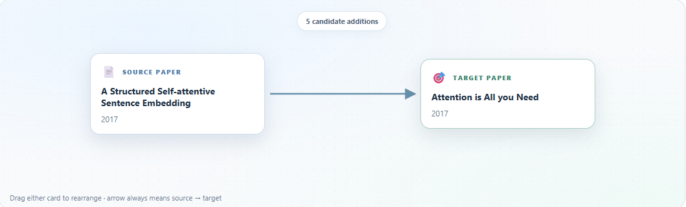
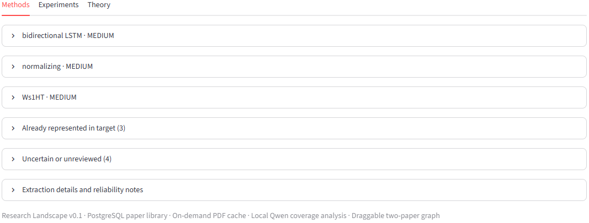

---
title: "Research Landscape"
subtitle: "An experimental tool for exploring relationships between academic papers"
toc: true
---

**Version:** 0.1  
**Status:** Early development

[GitHub Repository](https://github.com/josephcasey922/research-landscape)

## Overview

Research Landscape is a project exploring how language models can be used to analyze and compare academic research.

The primary goal is to identify ways in which existing research might contribute to or strengthen another paper. Rather than simply finding papers on similar topics, the project focuses on differences in research methods, experimental approaches, and other components.

The longer-term objective is to develop an interactive representation of a research landscape, allowing users to explore relationships between papers and identify potentially useful contributions.

## Version 0.1

The first version focuses on comparing individual pairs of research papers.

Given a **target paper** and a **source paper**, the system attempts to identify:

- Research components present in each paper.
- Components in the source paper that may strengthen existing components of the target.
- Components that may introduce new approaches or perspectives.
- Supporting evidence from the papers for these comparisons.

The application uses a locally running language model to perform the analysis and presents the results through an interactive visualization.

### Current Features

- A searchable paper library backed by PostgreSQL.
- PDF retrieval and local caching.
- Research component extraction using a local language model.
- Evidence-linked comparisons and suggested contributions.
- Saved paper comparisons.
- An interactive, draggable graph for visualizing relationships.

## App

### Paper Selection and Comparison

### Interactive Visualization

### Sample Output

## Limitations and Future Development

Version 0.1 is an initial prototype, and its generated comparisons should be considered provisional rather than definitive assessments of academic research.

In particular, identifying a potentially useful contribution does not necessarily imply that one paper is better than another.

Some possible directions for future development include:

- Expanding from pairwise comparisons to larger collections of papers.
- Identifying clusters of related research.
- Developing more systematic measures of research component coverage.
- Improving the accuracy and consistency of model-generated comparisons.
- Expanding the interactive visualization.

## Source Code

The code and implementation details are available on GitHub.

[View the Project on GitHub](https://github.com/josephcasey922/research-landscape)
